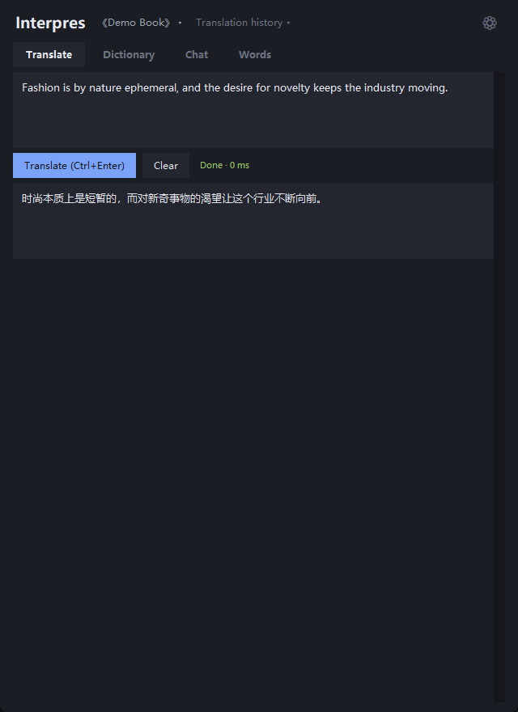
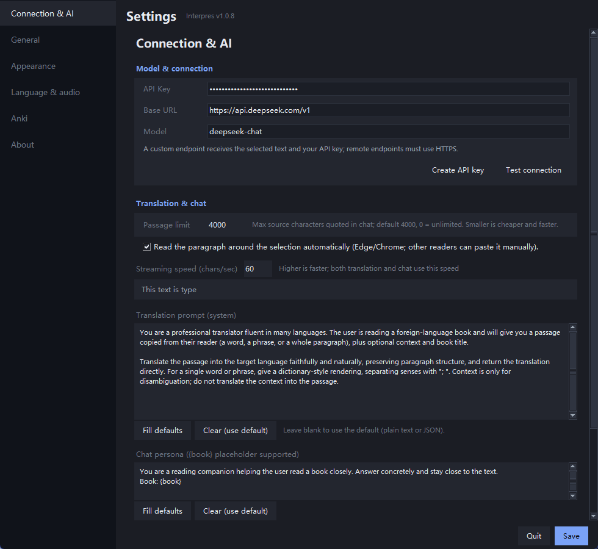
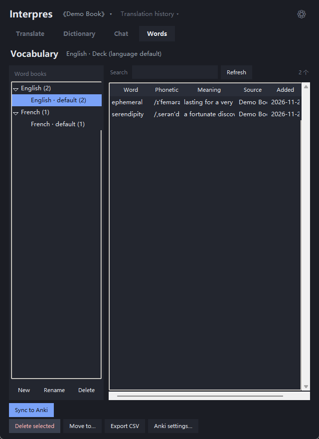
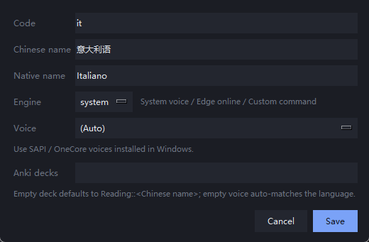
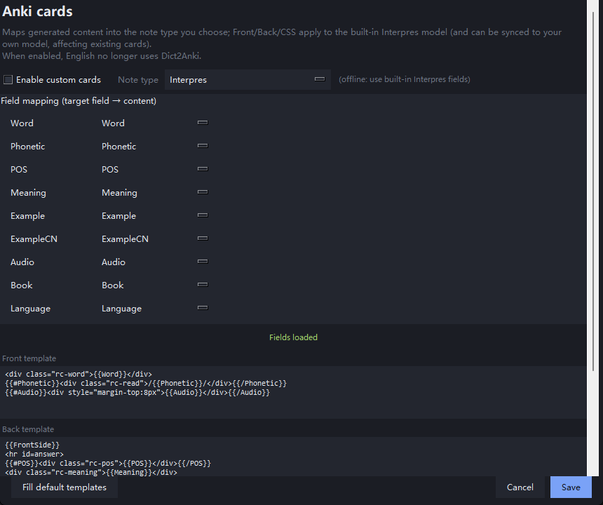

# Interpres

A Windows reading companion for foreign-language books: select text in your reader, get a translation with real dictionary definitions, keep vocabulary per language, and sync it to Anki.

English | [中文说明](docs/README.zh-CN.md)



## Features

- **Selection translation** — press `Ctrl+Alt+T` over selected text (or click the floating “译” button) and get a translation next to it. Works in Chrome, Edge, Firefox, Calibre, SumatraPDF, Acrobat, Okular and Thorium.
- **Local MDX/MDD dictionaries** — bring your own Longman, Oxford, etc. Lookup is offline; fuzzy search handles accents and typos. The AI only fills context that the dictionary cannot.
- **AI chat with context** — ask questions about the passage or the book; the current paragraph and translation are sent along so answers stay grounded.
- **Per-language vocabulary books** — words are grouped by language, and you can create your own word books (e.g. “English · IELTS”). Each book maps to its own Anki deck.
- **Anki sync** — English uses the [Dict2Anki](https://github.com/ninja33/anki-dict-helper) note type by default; other languages use the bundled `Interpres` note type with structured senses, examples and audio.
- **Languages are data, not code** — add any language (Italian, Japanese, Russian, …): code, display name, voice, deck. Dictionaries attach per language.
- **TTS** — Windows SAPI/OneCore voices, Edge online neural voices, or a custom command (Piper, eSpeak, your own script).
- **Streaming UI** — translation and chat stream at a configurable character speed.
- **Tray icon, Chinese/English UI (language switch restarts automatically), dark theme.**

| Settings | Vocabulary | Language setup |
|---|---|---|
|  |  |  |

## What this project does not include

This is a personal tool, not a product. It does **not** ship or provide:

- **Dictionaries** — no Longman, Oxford, or other dictionary files. You must obtain them legally and add them yourself.
- **An API key or free quota** — you need your own DeepSeek (or OpenAI-compatible) key; API usage is billed by your provider.
- **Anki data or a sync service** — Anki and AnkiConnect must be installed and running locally before card sync works.
- **Books or reading content** — you bring your own files.
- **Accounts, cloud sync, telemetry, analytics, or auto-update** — there is no server-side account, no usage collection, and no update mechanism.
- **An installer or background service** — it is a portable executable; it does not install system services or run elevated.
- **A code signature** — the executable is not Authenticode-signed, so Windows may show a security prompt. The project does not tell you to bypass it; whether to run the file is your decision.
- **A stable update or fix promise** — issues are welcome, but there is no fixed release schedule and no guarantee that every problem will be fixed.

What you *do* get is the source, the build script, and a local-first workflow you can inspect and modify.

## Requirements

- Windows 10/11 (64-bit)
- Your own DeepSeek API key (or any OpenAI-compatible endpoint)
- Optional: [Anki](https://apps.ankiweb.net/) + [AnkiConnect](https://ankiweb.net/shared/info/2055492159) for card sync
- Optional: MDX/MDD dictionaries (not bundled, see below)

## Quick start

1. Download `Interpres.zip` from Releases and extract it.
2. Run `Interpres.exe` from the extracted folder. It is portable and keeps its data in your user profile; nothing is installed system-wide.
3. Open settings (`Ctrl+Alt+S`), paste your API key, click **Test connection**.
4. Select text in a reader and press `Ctrl+Alt+T`.

Hotkeys:

| Hotkey | Action |
|---|---|
| `Ctrl+Alt+T` | Translate selection / open panel |
| `Ctrl+Alt+S` | Open panel |
| `Esc` | Close panel (behaviour configurable) |

## Anki cards



By default the sync uses two note types:

- **Dict2Anki** for English (when installed and enabled in settings)
- **Interpres** for other languages, with structured senses, paired examples, audio and the book title

To customise cards, open **Settings → Anki → 卡片模板…**:

- choose any existing note type and map its fields to the generated content
  (Word, Phonetic, POS, Meaning, Example, ExampleCN, Audio, Book, Language)
- edit Front/Back templates and CSS; the built-in templates are the defaults
- optionally push templates/CSS to Anki (`updateModelTemplates` /
  `updateModelStyling`); this re-renders existing cards, and for a note type you
  created yourself you will be asked to confirm
- enabling custom cards applies to **all languages**, including English, which
  then bypasses Dict2Anki

Field mapping never deletes fields from your note type; unmapped target fields
are left empty.

### Per-wordbook settings

Open **Words tab → Anki 设置…** to configure cards for one wordbook:

- **Follow global** (default): shares the global note type and templates from
  Settings → Card templates
- **Independent**: creates a note type named `Interpres · <wordbook>`; its
  templates belong to that book only, and are created on first sync
- **Existing note type**: map fields to one of your note types; all wordbooks
  using that type share its templates

Each wordbook already has its own deck, so the three modes can be mixed freely.
Templates live on the note type, not on the deck: when several books share a
type, editing its template affects its first card template only; other templates
are left untouched, and the dialog warns first.

## Dictionaries

The app does not ship dictionaries. Put `.mdx`/`.mdd` files anywhere and add them in **Settings → 语言、词典与发音 → 词典设置…**. The parser supports MDX 2.0; encrypted or MDX 1.2 files are not supported yet.

The original-entry viewer keeps the dictionary's HTML and CSS, but removes
dictionary-provided `<script>` tags, `on*` handlers, and `javascript:` links
before rendering. Its own toolbar buttons are handled by the app's injected
script; a dictionary that depends on custom JavaScript interactivity will look
correct but not run its own scripts.

Dictionaries are copyrighted works; obtain and use them legally. Dictionary files are never sent anywhere — lookup is entirely local.

If your dictionary uses an unusual HTML layout, map it without code via **Settings → 语言、词典与发音 → 词典设置… → 词典映射…**. Schema and a working Longman example: [docs/DICT_PROFILES.md](docs/DICT_PROFILES.md).

## Data & privacy

All settings and data live in `%USERPROFILE%\.reading-companion\`:

```
config.json   settings (API key encrypted with Windows DPAPI)
reading.db    vocabulary, conversations, translation cache
app.log       logs (no selected text or document bodies)
cache/        TTS audio cache
exports/      CSV/TSV/Markdown exports
```

Network access is limited to:

- your configured API base URL (translation, chat, term extraction)
- `127.0.0.1:8765` (AnkiConnect, if enabled)
- Microsoft Edge TTS endpoints (only if you select the Edge engine)

No telemetry. The API key is encrypted at rest with Windows DPAPI and never
leaves your machine except as a request to the endpoint you configured.

## Run from source

Requires Python 3.12 and PowerShell:

```powershell
pip install -r requirements.lock --target vendor
python app.py
```

`vendor/` is only used for local runs; the packaged exe bundles these dependencies.
`requirements.lock` pins the exact transitive set; `requirements.txt` keeps the
direct-dependency ranges for development.

Build the portable folder release:

```powershell
powershell -ExecutionPolicy Bypass -File .\build_portable.ps1
```

Outputs `dist\Interpres.zip`, which contains `Interpres.exe` and its `_internal` folder. The single-file script `build_exe.ps1` is kept for development, but the release uses the folder build because some Windows security policies block onefile extraction into `%TEMP%`.

Tests:

```powershell
python tests\run_checks.py
python tests\test_panel.py
python tests\test_ux_flows.py
python tests\test_ux_scenarios.py
```

`tests\run_checks.py` is the automated CI gate. The `tests\test_*.py` scripts
are direct assertions; some need a Windows desktop, clipboard, or Anki.
`tests\ui_*.py` are manual probes and screenshot tools, not part of CI.

Static checks are also part of the gate (`ruff.toml`); they must stay clean:

```powershell
python -m pip install -r requirements-dev.txt
ruff check .
```

See [`docs/TESTING.md`](docs/TESTING.md) for the release checklist and the
difference between automated checks and manual probes.

Some tests use a mock OpenAI/AnkiConnect server; Anki integration tests skip automatically when Anki is not running.

## Architecture

```
app.py              entry point, hotkeys, tray, local HTTP API
rc/service.py       translation pipeline, dictionaries, vocabulary, Anki
rc/llm.py           chat/translation client (streaming, JSON parsing)
rc/rich.py          dictionary HTML → structured senses/examples
rc/mdx.py           pure-stdlib MDX/MDD reader
rc/panel.py         main window (translate / dictionary / chat / words)
rc/popup.py         selection popup and bubble
rc/store.py         SQLite storage
rc/i18n.py          zh/en display-layer translation
```

## Known limitations and rough edges

- The code was generated by an AI agent and has not been reviewed by a professional developer. Treat it as an experimental personal project.
- Testing was done on the author's own Windows machine and a handful of readers; other apps, DPI settings and Windows versions are not covered.
- Text selection capture relies on clipboard simulation; some apps with unusual selection handling will not work.
- Only one MDX dictionary per language is used for lookup; there is no merged multi-dictionary view.
- MDX 1.2 and encrypted dictionaries are not supported.
- Latin has no native TTS voice; the app falls back to Italian (Edge) or French (SAPI).
- Edge TTS is an unofficial Microsoft endpoint and may change without notice.
- Anki sync depends on AnkiConnect and a running Anki instance; there is no offline queue or retry.
- There is no automatic update, no cloud backup, and no telemetry. Back up `%USERPROFILE%\.reading-companion\` yourself.
- The English UI is a translation layer over Chinese strings; some rarely used dialogs may still contain Chinese text.
- No formal accessibility or localization review has been done.

## How this was built

This project was written by an **AI coding agent** (DeepSeek models, run through
DeepSeek Harness). The human author is **not a programmer**: this is their first
project of this kind, put together over a few days by describing what they
wanted and testing each build on real books. The author set the requirements,
made the product decisions, reported bugs, and accepted or rejected changes; the
agent produced the code, tests and documentation.

It is published in the hope that it helps other people with the same reading
workflow. It is **not** a polished product and comes with no support promise.

Practical implications:

- Treat it as an AI-generated codebase: review before relying on it for anything
  sensitive, and expect rough edges in rarely used paths.
- In some jurisdictions, works generated solely by AI may not attract copyright
  protection. The MIT license here applies to the extent the author can license
  the work; no warranty is given either way.
- Issues and suggestions are welcome, but responses may be slow. The author may
  not be able to judge or fix every technical problem without help.

## License

Project code is released under the **MIT License** (see `LICENSE`). Bundled third-party components have their own licenses — see `THIRD_PARTY_NOTICES.md`. In particular, `pystray` and `edge-tts` are LGPL-3.0; their license texts are in `licenses/`, and upstream source links are listed in the notices.

Dictionaries, book covers and other content you load are your responsibility.
