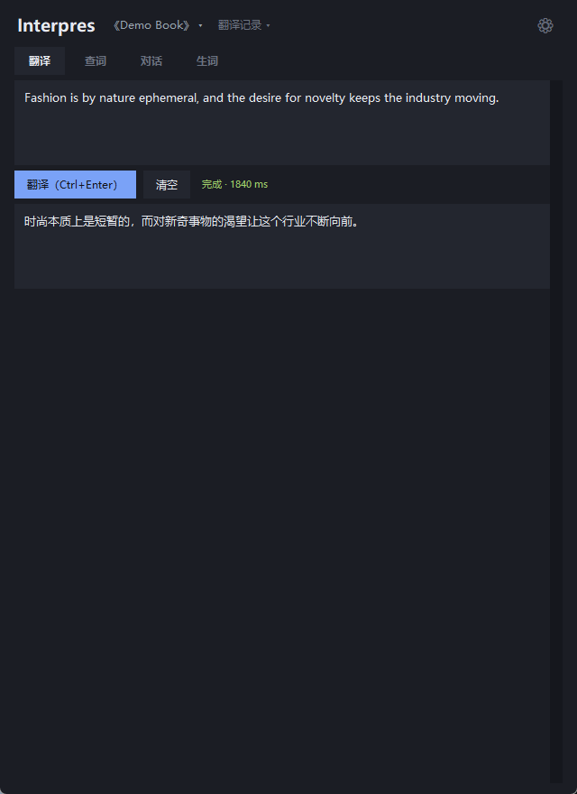
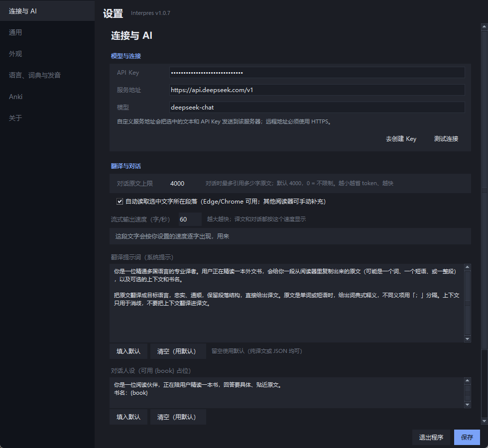
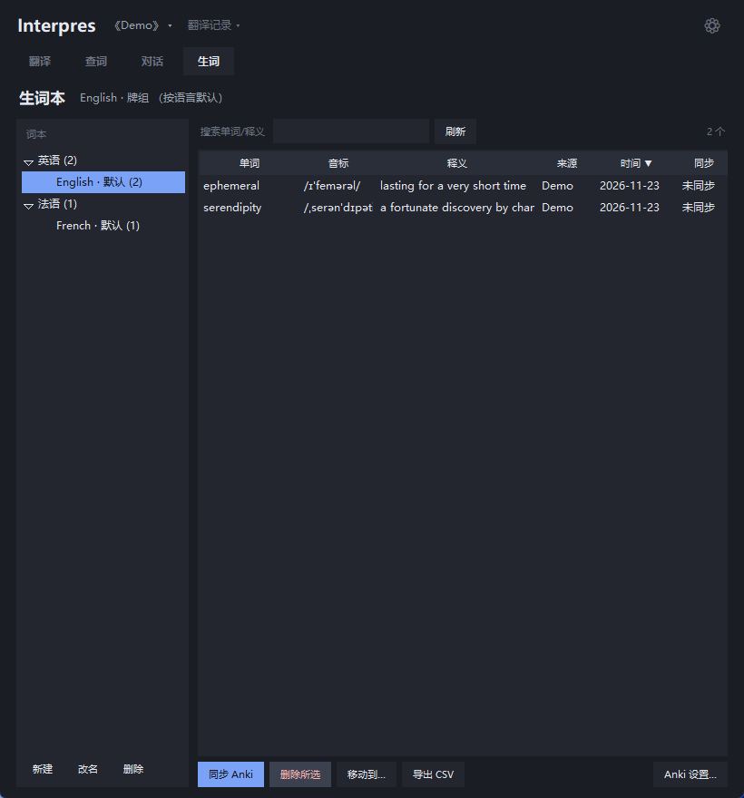
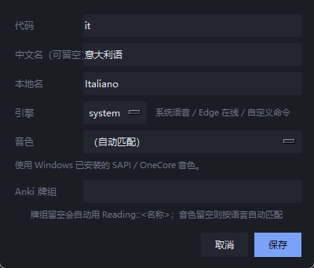
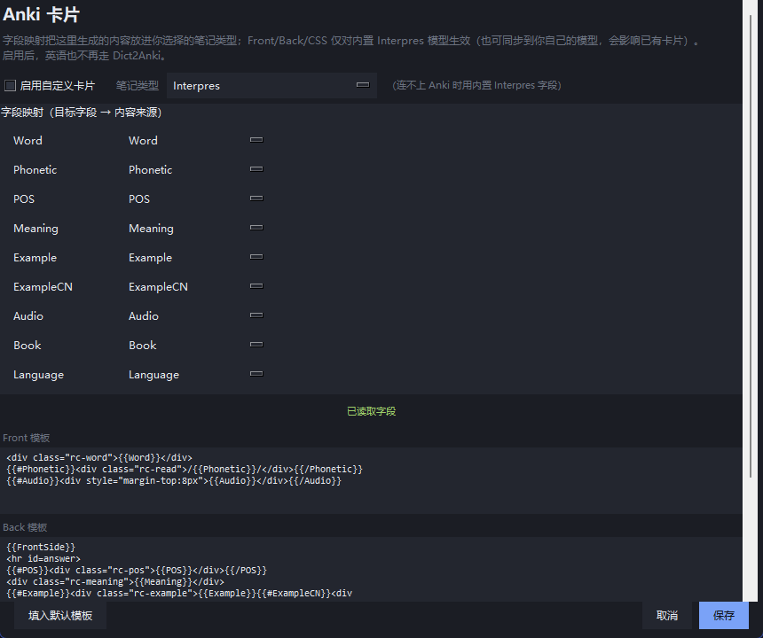

# Interpres 中文说明

一款 Windows 外文阅读助手：在阅读器里选中文字，按 `Ctrl+Alt+T` 翻译；结合本地 MDX 词典给出音标、释义和例句；生词按语言分本管理，可同步到 Anki。

[English](../README.md) | 中文



## 功能

- **划词翻译**：选中文字后按 `Ctrl+Alt+T`，或点选区旁的「译」按钮，在原文旁给出译文。支持 Chrome、Edge、Firefox、Calibre、SumatraPDF、Acrobat、Okular、Thorium。
- **本地 MDX/MDD 词典**：自己准备朗文、牛津等词典；查词完全离线，模糊匹配能处理重音和拼写错误。AI 只补词典没有的上下文。
- **结合上下文的 AI 对话**：可以问当前段落或整本书的问题；在 Edge/Chrome 里会自动读取选中文字所在段落（设置里可关），其他阅读器可以手动补充上下文。
- **按语言分本的生词本**：单词按语言分组，也可以自建词本（例如「英语 · 雅思」）。每本词本对应独立的 Anki 牌组。
- **Anki 同步**：英语默认使用 [Dict2Anki](https://github.com/ninja33/anki-dict-helper) 笔记类型；其他语言使用内置的 `Interpres` 笔记类型，包含结构化义项、成对例句和音频。
- **语言是数据，不是代码**：可以添加任意语言（意大利语、日语、俄语……），填代码、显示名、音色和牌组即可；词典按语言挂载。
- **发音**：Windows SAPI/OneCore、Edge 在线神经音色，或自定义命令（Piper、eSpeak、自己的脚本）。
- **流式显示**：译文和对话按可配置的字速逐字显示。
- **记录**：翻译记录和对话记录按书分组，可搜索，可导出 Markdown / TSV / CSV。
- **生词卡片**：在生词本里双击一个词，弹出它的词典卡片；没配词典时显示保存的释义和例句。
  单词表可按单词或释义搜索，点列头排序（单词/音标/释义/来源/时间/同步），选择会被记住。
- **本地 HTTP 接口**：仅回环、带 token，方便自己写脚本调用（翻译、生词、术语、发音、Anki 推送）。
- **托盘图标、中英文界面（切换语言会自动重启）、深色主题。**

| 设置 | 生词本 | 添加语言 |
|---|---|---|
|  |  |  |

## 环境

- Windows 10/11 64 位
- 自己的 DeepSeek API Key（或任意 OpenAI 兼容接口）
- 可选：[Anki](https://apps.ankiweb.net/) + [AnkiConnect](https://ankiweb.net/shared/info/2055492159)，用于同步卡片
- 可选：MDX/MDD 词典（不随软件分发，见下文）

## 这个项目没有什么

这是一个个人工具，不是商业产品。它**不提供**：

- **词典**：没有朗文、牛津或任何词典文件；需要你自己合法获取并导入。
- **API Key 或免费额度**：需要你自己的 DeepSeek（或 OpenAI 兼容）Key，调用费用由你的服务商收取。
- **Anki 数据或同步服务**：必须先在本机安装并运行 Anki + AnkiConnect，卡片同步才可用。
- **书籍或阅读内容**：需要你自己准备。
- **账号、云同步、遥测、统计或自动更新**：没有服务端账号，不收集使用数据，也没有更新机制。
- **安装程序或后台服务**：它是绿色版 exe，不安装系统服务，也不需要管理员权限。
- **代码签名**：exe 没有 Authenticode 签名，Windows 可能弹出安全提示。项目不会引导你绕过提示，是否继续运行由你决定。
- **稳定的更新或修复承诺**：欢迎提 issue，但没有固定发布节奏，也不保证每个问题都会被修复。

它**有**的是源码、构建脚本，以及一个可以自己检查、修改的本地优先工作流。

## 快速开始

1. 从 Releases 下载 `Interpres.zip` 并解压。
2. 进入解压后的文件夹，运行 `Interpres.exe`。它是绿色版，数据保存在用户目录，不往系统里安装东西。
3. 按 `Ctrl+Alt+S` 打开主面板，点右上角齿轮进入设置，填入 API Key，点 **测试连接**。
4. 在阅读器里选中文字，按 `Ctrl+Alt+T`。

每个版本改了什么：见 [`CHANGELOG.md`](../CHANGELOG.md) 或 Releases 页面。

热键：

| 热键 | 作用 |
|---|---|
| `Ctrl+Alt+T` | 翻译选区 / 打开面板 |
| `Ctrl+Alt+S` | 打开面板 |
| `Esc` | 关闭面板（行为可配置） |

## 卸载

程序是绿色版，没有安装器。运行解压目录里的 `uninstall.ps1` 即可：它会退出正在运行的实例、
删除桌面/开机自启快捷方式，并在询问后决定是否删除 `%USERPROFILE%\.reading-companion`
（生词本、翻译记录、设置）。加 `-KeepData` 直接保留数据，加 `-DryRun` 只打印不执行。

也可以直接删掉程序文件夹——数据目录会保留，需要自己再删。

## Anki 卡片



默认两套笔记类型：

- **Dict2Anki**：英语，需已安装并在设置中启用
- **Interpres**：其他语言，包含结构化义项、成对例句、音频和书名

要自定义卡片，打开 **设置 → Anki → 卡片模板…**：

- 选择任意已有笔记类型，把它的字段映射到生成内容（Word、Phonetic、POS、Meaning、Example、ExampleCN、Audio、Book、Language）
- 编辑 Front/Back 模板和 CSS，默认就是内置那套
- 可勾选把模板/CSS 同步到 Anki（`updateModelTemplates` / `updateModelStyling`），已有卡片会重新渲染；若是你自己的笔记类型，会先弹确认
- 启用自定义后对**所有语言**生效，英语也不再走 Dict2Anki

字段映射只会填字段，不会删除你笔记类型里的字段；没映射的目标字段留空。

### 每个词本单独设置

生词本页 →「Anki 设置…」，可以按词本选择：

- **跟随全局默认**（默认）：和设置里的「卡片模板…」共用笔记类型与模板
- **独立模板**：自动创建「Interpres · 词本名」，模板只属于这本，首次同步时创建
- **选择已有笔记类型**：映射到你自己的类型；所有引用它的词本共享模板

牌组本来就按词本走，所以三种模式可以混用。模板属于笔记类型而不是牌组：多本共用同一类型时，改模板会影响它们，保存前会提示。

## 词典

软件不带词典。把 `.mdx`/`.mdd` 放到任意位置，在 **设置 → 语言、词典与发音 → 词典设置** 里添加。解析器支持 MDX 2.0；加密词典和 MDX 1.2 暂不支持。

词典是有版权的作品，请合法获取和使用。词典文件不会被发送到任何地方，查询完全在本地进行。

如果你的词典 HTML 结构特殊，不用改代码，可以在 **设置 → 语言、词典与发音 → 词典设置… → 词典映射…** 里配置。字段格式和朗文示例见 [DICT_PROFILES.md](DICT_PROFILES.md)。

## 数据与隐私

所有设置和数据都在 `%USERPROFILE%\.reading-companion\`：

```
config.json   设置（API Key 用 Windows DPAPI 加密，仅本地）
reading.db    生词、对话、翻译缓存
app.log       日志（不记录选中文本正文）
cache/        TTS 音频缓存
exports/      CSV/TSV/Markdown 导出
```

联网只发生在：

- 你配置的 API 地址（翻译、对话、提取生词）
- `127.0.0.1:8765`（AnkiConnect，启用时）
- Microsoft Edge TTS 接口（仅当选了 Edge 引擎时）

没有遥测。API Key 用 Windows DPAPI 加密后存在本地，除了向你自己配置的接口发请求，不会离开这台机器。

## 本地 HTTP 接口

程序还会在 `127.0.0.1:18777` 监听（端口可用 `server_port` 调整）。除 `GET /api/health` 外，
请求都要带 `X-RC-Token` 头，值就是 `config.json` 里的 `server_token`；服务只绑定回环，
请求体上限 1 MiB。

- `GET /api/health`、`GET /api/status`
- `POST /api/translate`、`GET|POST /api/vocab`、`GET|POST /api/glossary`
- `POST /api/anki/push`、`POST /api/export`、`POST /api/speak`、`GET /api/tts`
- `POST /api/config/test`、`POST /api/config`、`POST /api/show-settings`、`POST /api/show-panel`

## 从源码运行

需要 Python 3.12 和 PowerShell：

```powershell
pip install -r requirements.lock --target vendor
python app.py
```

`requirements.lock` 固定了精确的传递依赖；`requirements.txt` 只写直接依赖的版本范围。
`vendor/` 只用于本地运行；打包后的 exe 已包含这些依赖。

打包便携文件夹版：

```powershell
powershell -ExecutionPolicy Bypass -File .\build_portable.ps1
```

输出 `dist\Interpres.zip`，里面是 `Interpres.exe` 和同目录的 `_internal`。单文件脚本 `build_exe.ps1` 仍保留供开发使用，但发布采用文件夹版，因为部分 Windows 安全策略会拦截单文件版向 `%TEMP%` 解压。

测试：

```powershell
python tests\run_checks.py
python tests\test_panel.py
python tests\test_ux_flows.py
python tests\test_ux_scenarios.py
```

部分测试使用模拟的 OpenAI/AnkiConnect 服务；Anki 未运行时，相关集成测试会自动跳过。

CI 除 `run_checks.py` 外还会跑回归脚本和 Tk 界面测试，完整列表见 `.github/workflows/checks.yml`。
静态检查（ruff）也是门禁的一部分，必须零告警：

```powershell
python -m pip install -r requirements-dev.txt
ruff check .
```

发布清单和“哪些测试必须手动跑”的区别见 [`TESTING.md`](TESTING.md)。

## 架构

```
app.py                    入口：应用外壳、热键、托盘、main()
app_panel.py              主面板接线：翻译、提问、历史窗口
app_flow.py               选区 → 气泡 → 详情 → 查词
app_media.py              收藏、Anki 推送、发音、术语锁定
rc/service.py             Service（mixin 组合）：对话、历史、状态
rc/service_base.py        mixin 共享属性的注解声明
rc/service_translate.py   翻译流程：分块、缓存、流式
rc/service_dict.py        查词、词形、词条 HTML
rc/service_vocab.py       生词本、语言、术语表
rc/service_anki.py        Anki 字段、模板、推送
rc/service_common.py      分块/缓存小工具
rc/llm.py                 翻译/对话客户端（流式、JSON 解析）
rc/rich.py                词典 HTML → 结构化义项/例句
rc/mdx.py                 纯标准库 MDX/MDD 读取
rc/panel.py               主窗口外壳：布局、书籍、滚动、状态
rc/panel_translate.py     翻译页：流式输出、进度、错误
rc/panel_dict.py          查词页：查询、义项、词形、收藏
rc/panel_chat.py          对话页：消息与流式回复
rc/panel_suggest.py       查词联想弹层与键盘处理
rc/vocab_panel.py         生词本外壳：布局、搜索、刷新
rc/vocab_table.py         单词表：排序、列宽、双击词卡
rc/vocab_books.py         词本列表与新建/改名/删除对话框
rc/vocab_actions.py       移动/删除/导出单词、Anki 同步
rc/popup.py               划词弹窗外壳：生命周期、定位、滚轮
rc/popup_dict.py          词典卡片：义项、词形、近义词
rc/popup_chat.py          内联对话卡片：气泡、输入栏、流式
rc/popup_result.py        翻译结果卡片：生词、语法、操作
rc/popup_common.py        弹窗小工具
rc/settings_ui.py         设置窗口外壳：分页、标签、共享控件
rc/settings_pages.py      设置窗口：每页一个构建函数
rc/settings_actions.py    设置窗口：保存、测试、对话框、导出
rc/settings_common.py     设置页共享的辅助函数
rc/config.py              配置文件、DPAPI 密钥存储、语言表
rc/server.py              仅回环的本地 HTTP API（token、大小限制）
rc/netpolicy.py           服务地址校验：只允许 HTTPS 或回环
rc/capture.py             剪贴板快照与选中文字捕获
rc/selection.py           拖选/双击选词的鼠标监听
rc/dictionary.py          单本 MDX 词典：查询、音频、词条 HTML
rc/dictmanager.py         按语言管理词典与缓存
rc/anki.py                AnkiConnect 客户端、字段与模板
rc/tts.py                 发音：SAPI、Edge 或自定义命令
rc/theme.py               共享配色与字体
rc/store.py               SQLite 存储
rc/i18n.py                中英文显示层翻译
# 其余对话框/子窗口：book_settings、entry_settings、selection_settings、
# dictionary_settings、dict_profiles、language_dialog、anki_card_settings、
# wordbook_anki_settings、vocab_panel、translation_ui、chat_ui
```

更完整的变更记录见 [`CHANGELOG.md`](../CHANGELOG.md)。

## 已知缺陷和没做好的地方

- 代码由 AI 生成，没有经过专业程序员审查；请把它当作实验性个人项目。
- 只在作者自己的 Windows 机器和少数几个阅读器上测试过，其他软件、缩放比例和系统版本没有覆盖。
- 划词依赖剪贴板模拟，少数选择处理特殊的程序可能不工作。
- API Key 用 Windows DPAPI 加密，换电脑或换 Windows 用户后需要重新填一次（生词本和历史记录可以直接拷）。
- 每种语言只使用一本 MDX 词典，没有多词典合并显示。
- 不支持 MDX 1.2 和加密词典。
- 拉丁语没有原生 TTS 音色，会回退到意大利语（Edge）或法语（SAPI）。
- Edge TTS 是非官方 Microsoft 接口，可能随时变化。
- Anki 同步依赖 AnkiConnect 和正在运行的 Anki；没有离线队列或失败重试。
- 没有自动更新、云备份或遥测；请自行备份 `%USERPROFILE%\.reading-companion\`。
- 英文界面是在中文字符串上做的翻译层，少数不常用的对话框可能仍会显示中文。
- 没有做过正式的无障碍和本地化审查。

## 这个项目是怎么写出来的

代码由 **AI 编程代理**（DeepSeek 模型，通过 DeepSeek Harness 运行）生成。作者**完全不懂编程**，这是第一次做这类东西：用几天时间描述需求、在真实书籍上测试每一版，然后决定接受或否决改动。人类负责需求、产品决策和反馈，AI 负责代码、测试和文档。

发布它只是觉得可能对同样阅读需求的人有帮助。它**不是**成熟产品，也不承诺任何支持。

需要知道的几点：

- 请把它当作 AI 生成的代码库：用于敏感场景前自行审查，冷门路径可能还不够打磨。
- 部分司法辖区里，完全由 AI 生成的作品可能不受著作权保护。此处的 MIT 许可在作者可授权的范围内适用，且不提供任何担保。
- 欢迎 issue 和建议，但回复可能较慢；作者不一定有能力判断或修复每个技术问题。

## 许可证

项目代码采用 **MIT**（见 `LICENSE`）。内置第三方组件有各自许可证，见 `THIRD_PARTY_NOTICES.md`。其中 `pystray` 和 `edge-tts` 是 **LGPL-3.0**，许可证原文在 `licenses/`，上游源码链接见第三方声明。

词典、书籍封面以及你加载的其他内容，由你自己负责。
